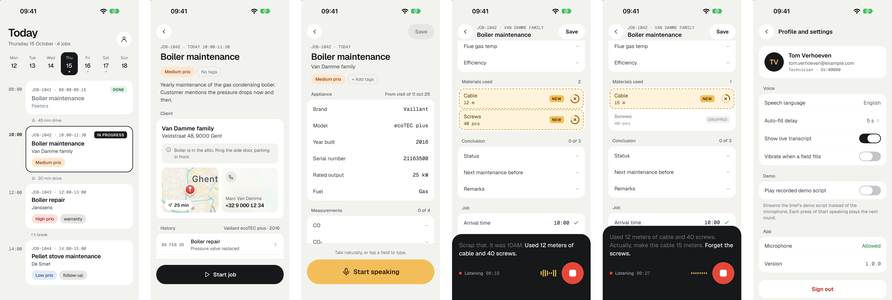
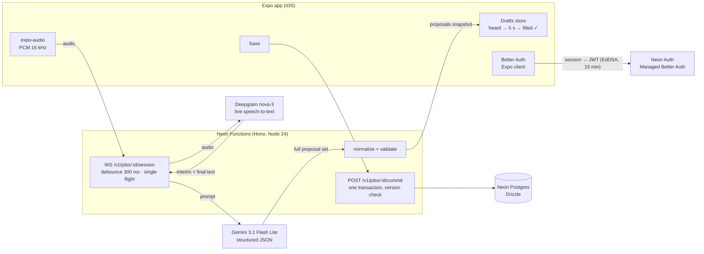

# Formcast

Formcast lets a field technician fill in a boiler maintenance job report by talking. While they speak, the form shows what will be saved: every change it heard lights up amber with a countdown, then settles into the form with a check. Nothing reaches the database until the technician taps **Save**.

Built for the Highsail full-stack case (Live Voice Form Filler). Designs: [docs/ux-flows.md](docs/ux-flows.md) · stack rationale: [docs/tech-stack.md](docs/tech-stack.md).

## Features

### In the app



Today · Job detail · Job form · Live proposals while talking · A spoken correction ("make the cable 15 meters, forget the screws") · Settings

### How it works



### Repository layout

| Path | Contents |
|---|---|
| `apps/mobile` | Expo app (Expo Router, iOS) |
| `apps/api` | Hono API. `src/index.ts` is the route table, one file per route in `src/routes`, the voice pipeline in `src/voice` |
| `packages/shared` | Form schema, proposal ops and their validation, wire protocol types |

## Getting started

Prerequisites: Node 24, pnpm, Xcode (iOS Simulator), the Neon CLI (`npm i -g neon`), accounts for Neon, Gemini and Deepgram.

```bash
pnpm install
neon link                       # writes .env.local with DATABASE_URL, NEON_AUTH_* …
cp apps/api/.env.example apps/api/.env.local   # add GEMINI_API_KEY and DEEPGRAM_API_KEY
pnpm db:migrate && pnpm db:seed # schema + demo data for today (re-run before a demo)
pnpm dev:api                    # neon dev → http://localhost:8787
```

The app reads `apps/mobile/.env`, which points at the deployed API and Neon Auth. Set `EXPO_PUBLIC_API_URL=http://localhost:8787` to use `neon dev` instead. Add `https://formcast.be` as a trusted domain in Neon Auth so sign-out works.

```bash
cd apps/mobile && npx expo run:ios   # development build (audio streaming needs native code)
```

Demo account: `tom.verhoeven@example.com` / `formcast-demo-2026`.

Deploy the API: `pnpm db:migrate && neon deploy` (migrations run as a deploy step, never inside the function).

### Checks

```bash
pnpm test                                   # shared: op validation, normalization, diffing
pnpm typecheck
pnpm --filter @formcast/mobile lint          # expo lint (incl. React hooks rules)
pnpm --filter @formcast/api replay          # demo script through the real model, step by step, with checks
pnpm --filter @formcast/api e2e:voice       # macOS `say` → PCM → WebSocket → Deepgram → Gemini → commit → DB checks
```

`e2e:voice` speaks both rounds of the brief's demo script in real time and asserts the saved result (arrival 10:00, one cable line of 15 m, priority high, tags `[warranty]`, stale commit → 409). The **Demo script** setting in the app streams the same recordings instead of the microphone, handy when a room is noisy or there's no mic.

## To be improved

A review pass over the first version. Each point started as a question about the code; some are already fixed, the rest are open.

### Already improved

- **Types inferred from Zod.** The proposal op types were written by hand next to their Zod schemas. `FieldOp`, `LineOp` and `ProposalSet` are now inferred from strict schemas, and the loose parsing schemas extend them, so types and validation can't drift apart.
- **No auth proxy in the API.** Sign-in used to go app → API → Neon Auth, with the API holding the session. Probing Neon Auth with fake credentials showed that only cookie-bearing POSTs are origin-checked, so the app now signs in with the Better Auth Expo client and the API only verifies JWTs. Passwords no longer pass through the API. The web build was dropped, since it would need cross-site cookies to Neon.
- **One file per route.** All routes lived in `index.ts` and `jobs.ts` mixed reads, starting a job and commit. `index.ts` is now the route table, each route has its own file, and a `jobs/` folder that only wrapped single-use functions was removed.
- **Readable code.** Blank lines between logical blocks across the API.

### Still open

- **Context to help Claude for further development** There is no PRODUCT.md or DESIGN.md file or any skills that would speed up git actions yet.
- **The whole transcript goes to Gemini on every run.** Within a session nothing is trimmed: 15 minutes of talking is about 2,000 words, re-sent every few seconds. Send only the recent segments (the pending set already captures what was said earlier) and run the model on pauses (Deepgram's `speech_final`) instead of on every final segment.
- **The transcript lives only in memory.** If the socket drops or the instance is evicted, the session's transcript is gone. The app keeps its proposals and sends them back on reconnect, but a resumable session needs the transcript stored server-side. That store would also give a session timeline for debugging and an eval set for running `replay` in CI.
- **Shared module names are vague.** `packages/shared` has `schema.ts`, `ops.ts` and `protocol.ts`, which sound alike. Rename after what they hold: the form definition (`form.ts`), the proposals (`proposals.ts`) and the wire contract.
- **The mobile app code hasn't been reviewed yet.** The review pass above covered the API and the shared package. `apps/mobile` still needs the same look at structure, naming and dead code.
- **Seed sign-up still uses the localhost origin.** Neon Auth requires an origin on sign-up, so `seed.ts` sends `Origin: http://localhost:8081`.

### Known limitations

- Verified on the iOS 27 Simulator with the Mac's microphone, not yet on a physical iPhone.
- iOS 27 requires the UIScene life cycle and Expo SDK 57's template doesn't adopt it yet, so `apps/mobile/plugins/withSceneLifecycle.js` wires up Expo's `ExpoAppSceneDelegate`.
- Unsaved proposals live in memory in the app: killing the app loses them.
- One technician, no tenancy: every signed-in user sees every job.
- Dutch speech isn't wired yet (Deepgram `language=en`).
- Travel time on the Today screen is the gap between jobs, not a real route ETA; the map tile ETA is static.
